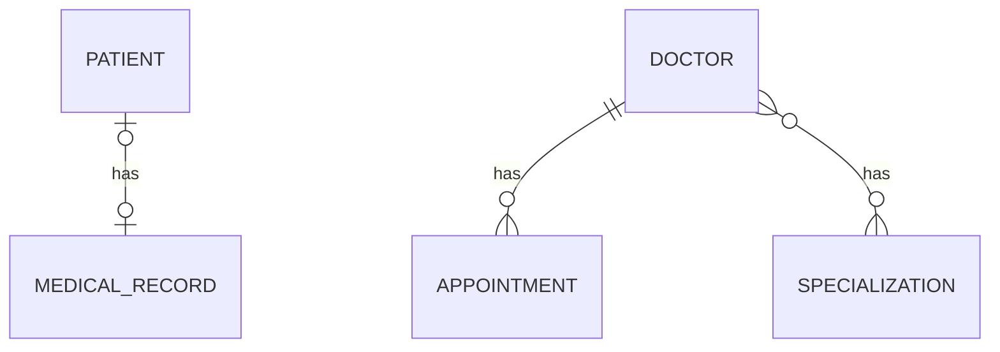

# Hospital Management API: Many-to-Many Branch

> Branch: `feature/many-to-many`
> This branch builds on `feature/one-to-many` and adds Specializations, linked to Doctors with a Many-to-Many relationship.

A Spring Boot REST API that manages patients, medical records, doctors, appointments and specializations. This branch completes the set of JPA relationships by adding **Many-to-Many** (uni-directional and bi-directional).

## What this branch covers

| Relationship | Entities | Direction |
|---|---|---|
| One-to-One | Patient and MedicalRecord | uni, then bi |
| One-to-Many / Many-to-One | Doctor and Appointment | bi |
| **Many-to-Many (new)** | Doctor and Specialization | uni, then bi |

## Tech Stack

| Area | Technology |
|---|---|
| Language | Java [17 version] |
| Framework | Spring Boot 4.1.1 |
| Persistence | Spring Data JPA, Hibernate |
| Database | MySQL |
| Others | Lombok, Maven |

## Database Design



| Table | Important columns |
|---|---|
| `patients` | `id`, `name`, `age`, `medical_record_id` (foreign key) |
| `medical_records` | `id`, `blood_group`, `diagnosis` |
| `doctors` | `id`, `name`, `experience` |
| `appointments` | `id`, `appointment_time`, `reason`, `doctor_id` (foreign key) |
| `specializations` | `id`, `name` (unique) |
| `doctor_specializations` | `doctor_id`, `specialization_id` (join table, both columns form the primary key) |

### How the Many-to-Many mapping is written

Neither table can hold the other's ids (a doctor has many specializations, and a specialization has many doctors), so Hibernate creates a third table, the **join table**. `DoctorEntity` is the owning side because it defines the `@JoinTable`.

```java
// DoctorEntity (owning side)
@ManyToMany
@JoinTable(
        name = "doctor_specializations",
        joinColumns = @JoinColumn(name = "doctor_id"),
        inverseJoinColumns = @JoinColumn(name = "specialization_id")
)
@Builder.Default
private Set<SpecializationEntity> specializations = new HashSet<>();

// SpecializationEntity (inverse side)
@ManyToMany(mappedBy = "specializations")
@Builder.Default
private Set<DoctorEntity> doctors = new HashSet<>();
```

## Project Structure

```
com.poonam.jpamapping
 ├── onetoone       (Patient, MedicalRecord)
 ├── onetomany      (Doctor, Appointment)
 └── manytomany     (Specialization)
      ├── entity
      ├── repository
      ├── service
      ├── controller
      └── dto
```

Request flow: `Controller -> Service -> Repository -> MySQL`. Entities are never returned directly; responses always go through DTOs.

## API Endpoints

| Method | URL | Description |
|---|---|---|
| POST | `/api/patient/create` | Create a patient with a medical record |
| GET | `/api/patient/read/{id}` | Get a patient by id |
| GET | `/api/medical-record/read/{id}` | Get a medical record with its patient |
| POST | `/api/doctors/create` | Create a doctor |
| GET | `/api/doctors/read/{id}` | Get a doctor with appointments and specializations |
| POST | `/api/appointment/create/{doctorId}` | Book an appointment for a doctor |
| POST | `/api/specializations/create` | Create a specialization |
| GET | `/api/specializations/read/{id}` | Get a specialization with all its doctors |
| POST | `/api/doctors/{doctorId}/specializations/{specializationId}` | Assign a specialization to a doctor |

### Sample requests

Create a specialization: `POST /api/specializations/create`

```json
{
  "name": "Cardiology"
}
```

Assign it to a doctor: `POST /api/doctors/1/specializations/1`

```
Specialization added to doctor successfully
```

Read the specialization with its doctors: `GET /api/specializations/read/1`

```json
{
  "id": 1,
  "name": "Cardiology",
  "doctors": [
    { "id": 1, "name": "Dr. Sharma", "experience": 10 },
    { "id": 3, "name": "Dr. Verma", "experience": 8 }
  ]
}
```

## Getting Started

### Prerequisites

- Java [17]
- Maven
- MySQL

### Setup

1. Clone the repository and switch to this branch

   ```bash
   git clone https://github.com/Poonam-D07/practice-jpa-mapping.git
   cd practice-jpa-mapping
   git checkout feature/many-to-many
   ```

2. Create the database

   ```sql
   CREATE DATABASE jpa_mapping_db;
   ```

3. Set your MySQL username and password in `src/main/resources/application.properties`

4. Run the application

   ```bash
   mvn spring-boot:run
   ```

   All tables, including the join table, are created automatically (`spring.jpa.hibernate.ddl-auto=update`).

5. Test the APIs with Postman at `http://localhost:8080`

## What I learned in this branch

- Why Many-to-Many needs a third (join) table, and that Hibernate creates it from `@JoinTable`
- `joinColumns` (this entity's column) vs `inverseJoinColumns` (the other entity's column)
- Using `Set` instead of `List`, so the same pair cannot be added twice
- Only changes made on the **owning side** are saved: adding through `doctor.getSpecializations()` writes to the join table
- Why `@Transactional` is used when linking two entities
- Why no `cascade` is used here: a specialization is shared between doctors, so deleting one doctor must not delete it

## Known limitations (fixed in later branches)

- No input validation yet: past appointment times and two appointments for the same doctor at the same time are accepted
- A missing id returns a generic 500 error instead of a clear 404
- No pagination, search or authentication

## Author

POONAM  (https://github.com/Poonam-D07)
