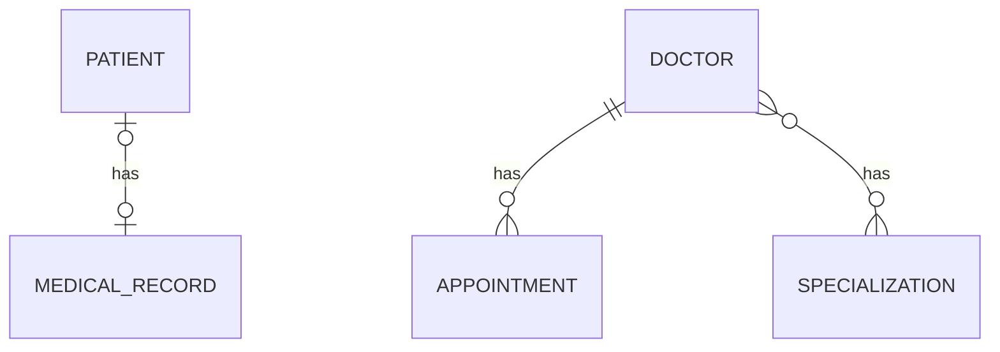

# Hospital Management API

A REST API built with Spring Boot to manage patients, doctors, appointments and specializations.
Built to practice JPA/Hibernate relationships (One-to-One, One-to-Many, Many-to-One, Many-to-Many) and grown into a secured backend with validation, error handling, pagination and JWT authentication.

## Features

- All four JPA relationships, uni-directional and bi-directional
- DTO layer (entities are never returned directly)
- Request validation with clear field-wise error messages
- Global exception handling (400, 401, 404, 409)
- Business rules: no appointments in the past, no double booking of the same doctor at the same time
- Pagination, sorting and search for doctors
- JWT authentication with role-based access (ADMIN, DOCTOR)
- Swagger UI for API documentation and testing

## Tech Stack

| Area | Technology |
|---|---|
| Language | Java [your Java version] |
| Framework | Spring Boot 4.1.1 |
| Persistence | Spring Data JPA, Hibernate |
| Database | MySQL |
| Security | Spring Security, JWT (jjwt 0.12.6), BCrypt |
| API docs | springdoc-openapi (Swagger UI) |
| Others | Lombok, Maven |

## Database Design



| Relationship | Entities | How it is stored |
|---|---|---|
| One-to-One (uni + bi) | Patient and MedicalRecord | `patients.medical_record_id` foreign key |
| One-to-Many / Many-to-One (uni + bi) | Doctor and Appointment | `appointments.doctor_id` foreign key |
| Many-to-Many (uni + bi) | Doctor and Specialization | join table `doctor_specializations` |

Owning sides: `PatientEntity` (One-to-One), `AppointmentEntity` (Many-to-One) and `DoctorEntity` (Many-to-Many). The other side uses `mappedBy`.

## Project Structure

```
com.poonam.jpamapping
 ├── onetoone      (Patient, MedicalRecord)
 ├── onetomany     (Doctor, Appointment)
 ├── manytomany    (Specialization)
 ├── auth          (User, JWT, login and register)
 ├── exception     (custom exceptions, global handler)
 ├── common        (PageResponseDto)
 └── config        (Security and Swagger config)
```

Each module follows the same flow: `Controller -> Service -> Repository -> MySQL`, with `entity` and `dto` packages.

## API Endpoints

| Method | URL | Access |
|---|---|---|
| POST | `/api/auth/register` | Public (creates a DOCTOR user) |
| POST | `/api/auth/login` | Public (returns a JWT) |
| POST | `/api/patient/create` | Logged in |
| GET | `/api/patient/read/{id}` | Logged in |
| GET | `/api/medical-record/read/{id}` | Logged in |
| POST | `/api/doctors/create` | ADMIN |
| GET | `/api/doctors/read/{id}` | Logged in (with appointments and specializations) |
| GET | `/api/doctors/readAll` | Logged in |
| GET | `/api/doctors/paged?page=0&size=5&sortBy=experience&direction=desc` | Logged in |
| GET | `/api/doctors/search?name=sharma` | Logged in |
| POST | `/api/doctors/{doctorId}/specializations/{specializationId}` | ADMIN |
| POST | `/api/appointment/create/{doctorId}` | Logged in |
| POST | `/api/specializations/create` | ADMIN |
| GET | `/api/specializations/read/{id}` | Logged in (with its doctors) |

## Error Responses

| Status | When |
|---|---|
| 400 | Validation failed (blank name, negative experience, past appointment time) |
| 401 | Wrong username or password |
| 403 | Missing or invalid token, or role not allowed |
| 404 | Resource not found |
| 409 | Username already taken, or the doctor already has an appointment at that time |

## Getting Started

### Prerequisites

- Java [your Java version]
- Maven
- MySQL

### Setup

1. Clone the repository

   ```bash
   git clone https://github.com/Poonam-D07/practice-jpa-mapping.git
   cd practice-jpa-mapping
   ```

2. Create the database

   ```sql
   CREATE DATABASE jpa_mapping_db;
   ```

3. Update the database username and password in `src/main/resources/application.properties`

4. Set the JWT secret as an environment variable (a random text of at least 32 characters). The secret is never stored in the code.

   ```
   JWT_SECRET=your_long_random_secret
   ```

5. Run the application

   ```bash
   mvn spring-boot:run
   ```

6. Open Swagger UI at `http://localhost:8080/swagger-ui/index.html`

### Trying the secured APIs

1. Register a user with `POST /api/auth/register`, then log in with `POST /api/auth/login` and copy the token.
2. Click **Authorize** in Swagger UI and paste the token.
3. To get an ADMIN user, register normally and change the role in the database:

   ```sql
   UPDATE users SET role = 'ADMIN' WHERE username = 'your_username';
   ```

   Log in again after this, because the role is stored inside the token.

## Roadmap

- Update and delete endpoints
- Unit and integration tests
- React frontend (login, doctors list with search and pagination, appointment booking)
- Docker and deployment

## Author

POONAM 
GitHub : https://github.com/Poonam-D07/practice-jpa-mapping
