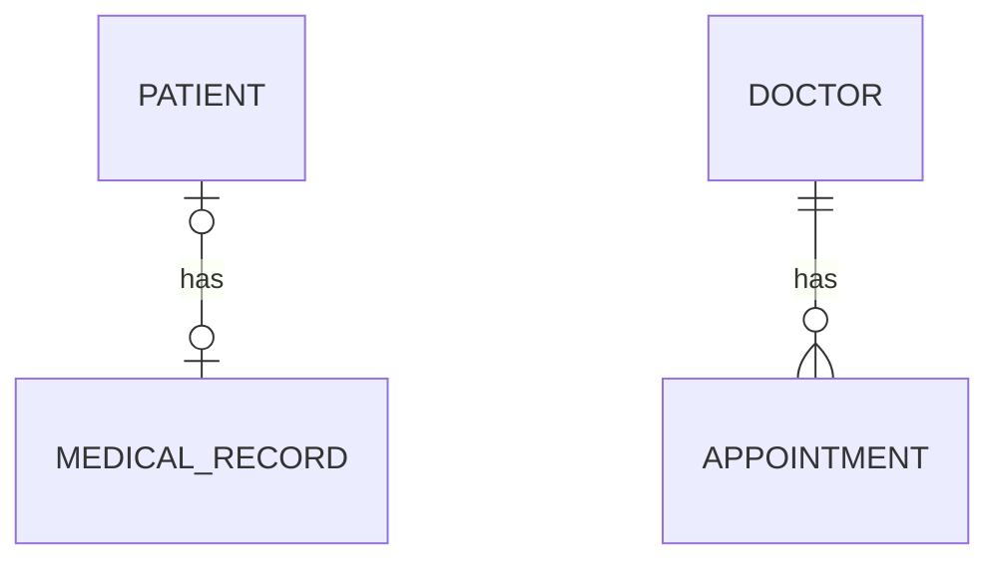

# Hospital Management API: One-to-Many Branch

> Branch: `feature/one-to-many`
> This branch builds on `main` (One-to-One) and adds the Doctor and Appointment modules.

A Spring Boot REST API that manages patients, medical records, doctors and appointments. This branch focuses on JPA relationships: **One-to-One** and **One-to-Many / Many-to-One**, both uni-directional and bi-directional.

## What this branch covers

| Relationship | Entities | Direction |
|---|---|---|
| One-to-One | Patient and MedicalRecord | uni, then bi |
| One-to-Many | Doctor to Appointments | bi |
| Many-to-One | Appointment to Doctor | bi |

## Tech Stack

| Area | Technology |
|---|---|
| Language | Java [17] |
| Framework | Spring Boot 4.1.1 |
| Persistence | Spring Data JPA, Hibernate |
| Database | MySQL |
| Others | Lombok, Maven |

## Database Design



| Table | Important columns |
|---|---|
| `patients` | `id`, `name`, `age`, `medical_record_id` (foreign key) |
| `medical_records` | `id`, `blood_group`, `diagnosis` |
| `doctors` | `id`, `name`, `experience` |
| `appointments` | `id`, `appointment_time`, `reason`, `doctor_id` (foreign key) |

### How the mappings are written

**One-to-One:** `PatientEntity` is the owning side (it holds the foreign key). `MedicalRecordEntity` is the inverse side.

```java
// PatientEntity (owning side)
@OneToOne(cascade = CascadeType.ALL)
@JoinColumn(name = "medical_record_id")
private MedicalRecordEntity medicalRecord;

// MedicalRecordEntity (inverse side)
@OneToOne(mappedBy = "medicalRecord")
private PatientEntity patient;
```

**One-to-Many / Many-to-One:** `AppointmentEntity` is the owning side because the foreign key lives in the "many" table.

```java
// AppointmentEntity (owning side)
@ManyToOne
@JoinColumn(name = "doctor_id")
private DoctorEntity doctor;

// DoctorEntity (inverse side)
@OneToMany(mappedBy = "doctor")
@Builder.Default
private List<AppointmentEntity> appointments = new ArrayList<>();
```

## Project Structure

```
com.poonam.jpamapping
 ├── onetoone
 │    ├── entity       (PatientEntity, MedicalRecordEntity)
 │    ├── repository
 │    ├── service
 │    ├── controller
 │    └── dto
 └── onetomany
      ├── entity       (DoctorEntity, AppointmentEntity)
      ├── repository
      ├── service
      ├── controller
      └── dto
```

Request flow: `Controller -> Service -> Repository -> MySQL`. Entities are never returned directly; responses always go through DTOs.

## API Endpoints

| Method | URL | Description |
|---|---|---|
| POST | `/api/patient/create` | Create a patient with a medical record |
| GET | `/api/patient/read/{id}` | Get a patient by id |
| GET | `/api/medical-record/read/{id}` | Get a medical record with its patient (bi-directional check) |
| POST | `/api/doctors/create` | Create a doctor |
| GET | `/api/doctors/read/{id}` | Get a doctor with all their appointments |
| POST | `/api/appointment/create/{doctorId}` | Book an appointment for a doctor |

### Sample requests

Create a patient: `POST /api/patient/create`

```json
{
  "name": "Rahul",
  "age": 30,
  "bloodGroup": "O+",
  "diagnosis": "Fever"
}
```

Response (201):

```json
{
  "id": 1,
  "name": "Rahul",
  "age": 30,
  "bloodGroup": "O+",
  "diagnosis": "Fever"
}
```

Book an appointment: `POST /api/appointment/create/1`

```json
{
  "appointmentTime": "2027-05-15T10:30:00",
  "reason": "Fever and cold"
}
```

## Getting Started

### Prerequisites

- Java 17
- Maven
- MySQL

### Setup

1. Clone the repository and switch to this branch

   ```bash
   git clone https://github.com/Poonam-D07/practice-jpa-mapping.git
   cd practice-jpa-mapping
   git checkout feature/one-to-many
   ```

2. Create the database

   ```sql
   CREATE DATABASE jpa_mapping_db;
   ```

3. Set your MySQL username and password in `src/main/resources/application.properties`

4. Run the application

   ```bash
   mvn spring-boot:run
   ```

   Tables are created automatically (`spring.jpa.hibernate.ddl-auto=update`).

5. Test the APIs with Postman at `http://localhost:8080`

## What I learned in this branch

- Owning side and inverse side, and why `mappedBy` is needed
- Where the foreign key lives in One-to-One and One-to-Many
- `@JoinColumn` and `cascade`
- Why DTOs are used instead of returning entities (also avoids infinite loops in bi-directional mappings)
- `@Builder.Default` for initialising collections when using Lombok's builder
- Setting the owning side correctly when linking an appointment to a doctor

## Known limitations (fixed in later branches)

- No input validation yet: past appointment times and two appointments for the same doctor at the same time are accepted
- A missing id returns a generic 500 error instead of a clear 404
- No pagination, search or authentication
- Many-to-Many (Doctor and Specialization) comes in `feature/many-to-many`

## Author

POONAM 
https://github.com/Poonam-D07
