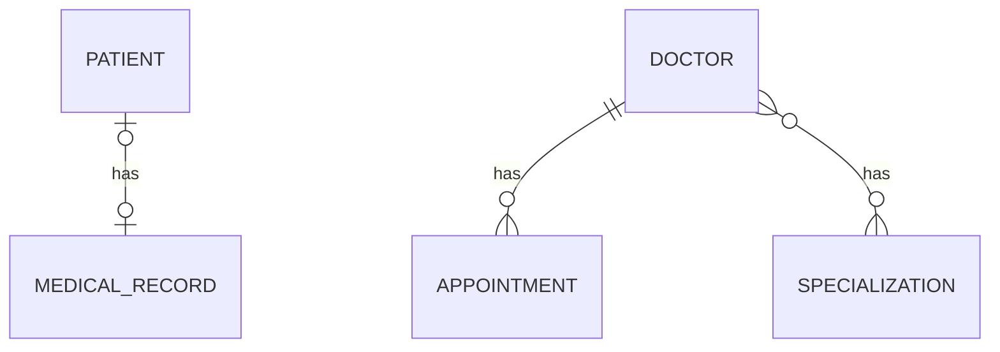

# Hospital Management API: Pagination, Sorting and Search Branch

> Branch: `feature/pagination-search`
> This branch builds on `feature/validation-exception` and adds list, pagination, sorting and search for doctors.

A Spring Boot REST API that manages patients, medical records, doctors, appointments and specializations. This branch makes the doctor list usable for real data sizes: instead of returning every row at once, the API returns one page at a time.

## What this branch adds

| Feature | Endpoint |
|---|---|
| List all doctors | `GET /api/doctors/readAll` |
| Pagination and sorting | `GET /api/doctors/paged` |
| Search by name (case-insensitive, with pagination) | `GET /api/doctors/search` |
| Reusable page response | `PageResponseDto<T>` in the `common` package |

## Tech Stack

| Area | Technology |
|---|---|
| Language | Java 17 |
| Framework | Spring Boot 4.1.1 |
| Persistence | Spring Data JPA, Hibernate |
| Validation | Jakarta Bean Validation |
| Database | MySQL |
| Others | Lombok, Maven |

## Database Design



| Relationship | Entities | How it is stored |
|---|---|---|
| One-to-One (uni + bi) | Patient and MedicalRecord | `patients.medical_record_id` foreign key |
| One-to-Many / Many-to-One (uni + bi) | Doctor and Appointment | `appointments.doctor_id` foreign key |
| Many-to-Many (uni + bi) | Doctor and Specialization | join table `doctor_specializations` |

## Pagination, Sorting and Search

### Query parameters

| Endpoint | Parameter | Default | Meaning |
|---|---|---|---|
| `/api/doctors/paged` | `page` | `0` | Page number, counting from 0 |
| `/api/doctors/paged` | `size` | `5` | Doctors per page |
| `/api/doctors/paged` | `sortBy` | `id` | Field to sort by (for example `name` or `experience`) |
| `/api/doctors/paged` | `direction` | `asc` | `asc` or `desc` |
| `/api/doctors/search` | `name` | required | Text that the doctor's name contains (case-insensitive) |
| `/api/doctors/search` | `page`, `size` | `0`, `5` | Same as above |

Examples:

```
GET /api/doctors/paged?page=0&size=2
GET /api/doctors/paged?sortBy=experience&direction=desc
GET /api/doctors/search?name=sharma
```

### Response shape

Every paged endpoint returns the same wrapper, built from Spring Data's `Page`:

```json
{
  "content": [
    { "id": 1, "name": "Dr. Sharma", "experience": 10 },
    { "id": 2, "name": "Dr. Sharma", "experience": 10 }
  ],
  "pageNumber": 0,
  "pageSize": 2,
  "totalElements": 6,
  "totalPages": 3,
  "last": false
}
```

`PageResponseDto<T>` is generic, so the same class can wrap any entity's DTO later.

### How it works

```java
// DoctorRepository: Spring builds the query from the method name
Page<DoctorEntity> findByNameContainingIgnoreCase(String name, Pageable pageable);

// DoctorServiceImpl
Sort sort = direction.equalsIgnoreCase("desc")
        ? Sort.by(sortBy).descending()
        : Sort.by(sortBy).ascending();
Pageable pageable = PageRequest.of(page, size, sort);
Page<DoctorEntity> doctorPage = doctorRepository.findAll(pageable);
```

Only the requested page is read from the database, not the whole table.

## Project Structure

```
com.poonam.jpamapping
 ├── onetoone       (Patient, MedicalRecord)
 ├── onetomany      (Doctor, Appointment)
 ├── manytomany     (Specialization)
 ├── exception      (custom exceptions, global handler)
 └── common         (PageResponseDto)
```

Request flow: `Controller -> Service -> Repository -> MySQL`. Entities are never returned directly; responses always go through DTOs.

## API Endpoints

| Method | URL | Description |
|---|---|---|
| POST | `/api/patient/create` | Create a patient with a medical record |
| GET | `/api/patient/read/{id}` | Get a patient by id |
| GET | `/api/medical-record/read/{id}` | Get a medical record with its patient |
| POST | `/api/doctors/create` | Create a doctor |
| GET | `/api/doctors/read/{id}` | Get a doctor with appointments and specializations |
| GET | `/api/doctors/readAll` | Get all doctors (no paging) |
| GET | `/api/doctors/paged` | Get doctors page by page, with sorting |
| GET | `/api/doctors/search?name=...` | Search doctors by name, page by page |
| POST | `/api/appointment/create/{doctorId}` | Book an appointment |
| POST | `/api/specializations/create` | Create a specialization |
| GET | `/api/specializations/read/{id}` | Get a specialization with all its doctors |
| POST | `/api/doctors/{doctorId}/specializations/{specializationId}` | Assign a specialization to a doctor |

Validation (400), not found (404) and conflict (409) responses work as described in the `feature/validation-exception` branch.

## Getting Started

### Prerequisites

- Java [17]
- Maven
- MySQL

### Setup

1. Clone the repository and switch to this branch

   ```bash
   git clone https://github.com/Poonam-D07/practice-jpa-mapping.git
   cd practice-jpa-mapping
   git checkout feature/pagination-search
   ```

2. Create the database

   ```sql
   CREATE DATABASE jpa_mapping_db;
   ```

3. Set your MySQL username and password in `src/main/resources/application.properties`

4. Run the application

   ```bash
   mvn spring-boot:run
   ```

5. Add a few doctors with `POST /api/doctors/create`, then try the paged and search URLs above in Postman at `http://localhost:8080`

## What I learned in this branch

- Why pagination matters: only one page is read from the database, so the API stays fast with large data
- `Pageable`, `PageRequest.of(page, size, sort)` and the `Page` result
- Sorting with `Sort.by(...).ascending()` and `.descending()`
- Query methods built from names: `findByNameContainingIgnoreCase`
- `@RequestParam` with `defaultValue` (vs `@PathVariable`)
- Writing a generic response class, `PageResponseDto<T>`

## Known limitations (fixed in later branches or planned)

- `sortBy` accepts any text, and an invalid field name is not handled with a friendly error yet
- `page` and `size` are not validated (for example a negative page)
- Search does not support sorting, and pagination exists only for doctors
- No authentication, and no API documentation page yet

## Author

POONAM  https://github.com/Poonam-D07
