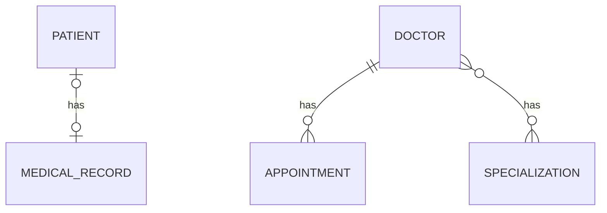

# Hospital Management API: Swagger Branch

> Branch: `feature/swagger`
> This branch builds on `feature/pagination-search` and adds interactive API documentation with Swagger UI.

A Spring Boot REST API that manages patients, medical records, doctors, appointments and specializations. This branch adds a documentation page where every endpoint can be read and tested from the browser, with no Postman needed.

<!-- Add a screenshot after saving it as docs/swagger.png, then remove the comment markers:

-->

## What this branch adds

| Feature | Details |
|---|---|
| Swagger UI | Interactive page listing all endpoints, with a "Try it out" button |
| OpenAPI document | Machine-readable API description, generated automatically |
| API info | Title, description and version shown at the top of the page |

| Page | URL |
|---|---|
| Swagger UI | `http://localhost:8080/swagger-ui/index.html` |
| OpenAPI JSON | `http://localhost:8080/v3/api-docs` |

## Tech Stack

| Area | Technology |
|---|---|
| Language | Java 17 |
| Framework | Spring Boot 4.1.1 |
| Persistence | Spring Data JPA, Hibernate |
| Validation | Jakarta Bean Validation |
| API docs | springdoc-openapi 3.0.3 (`springdoc-openapi-starter-webmvc-ui`) |
| Database | MySQL |
| Others | Lombok, Maven |

## How Swagger is set up

1. Add the dependency in `pom.xml`:

   ```xml
   <dependency>
       <groupId>org.springdoc</groupId>
       <artifactId>springdoc-openapi-starter-webmvc-ui</artifactId>
       <version>3.0.3</version>
   </dependency>
   ```

2. Describe the API in a configuration class (`config/OpenApiConfig.java`):

   ```java
   @Configuration
   public class OpenApiConfig {

       @Bean
       public OpenAPI hospitalOpenAPI() {
           return new OpenAPI()
                   .info(new Info()
                           .title("Hospital Management API")
                           .description("Manage patients, doctors, appointments and specializations.")
                           .version("1.0"));
       }
   }
   ```

3. Run the app and open the Swagger UI URL above. Endpoints are grouped by controller (`patient-controller`, `doctor-controller`, and so on). Springdoc builds this from the controllers and DTOs, so it stays in sync with the code.

## Database Design



| Relationship | Entities | How it is stored |
|---|---|---|
| One-to-One (uni + bi) | Patient and MedicalRecord | `patients.medical_record_id` foreign key |
| One-to-Many / Many-to-One (uni + bi) | Doctor and Appointment | `appointments.doctor_id` foreign key |
| Many-to-Many (uni + bi) | Doctor and Specialization | join table `doctor_specializations` |

## Project Structure

```
com.poonam.jpamapping
 ├── onetoone       (Patient, MedicalRecord)
 ├── onetomany      (Doctor, Appointment)
 ├── manytomany     (Specialization)
 ├── exception      (custom exceptions, global handler)
 ├── common         (PageResponseDto)
 └── config         (OpenApiConfig)
```

Request flow: `Controller -> Service -> Repository -> MySQL`. Entities are never returned directly; responses always go through DTOs.

## API Endpoints

| Method | URL | Description |
|---|---|---|
| POST | `/api/patient/create` | Create a patient with a medical record |
| GET | `/api/patient/read/{id}` | Get a patient by id |
| GET | `/api/medical-record/read/{id}` | Get a medical record with its patient |
| POST | `/api/doctors/create` | Create a doctor |
| GET | `/api/doctors/read/{id}` | Get a doctor with appointments and specializations |
| GET | `/api/doctors/readAll` | Get all doctors (no paging) |
| GET | `/api/doctors/paged` | Get doctors page by page, with sorting |
| GET | `/api/doctors/search?name=...` | Search doctors by name, page by page |
| POST | `/api/appointment/create/{doctorId}` | Book an appointment |
| POST | `/api/specializations/create` | Create a specialization |
| GET | `/api/specializations/read/{id}` | Get a specialization with all its doctors |
| POST | `/api/doctors/{doctorId}/specializations/{specializationId}` | Assign a specialization to a doctor |

Validation (400), not found (404), conflict (409) and pagination work as described in the earlier branches.

## Getting Started

### Prerequisites

- Java 17
- Maven
- MySQL

### Setup

1. Clone the repository and switch to this branch

   ```bash
   git clone https://github.com/Poonam-D07/practice-jpa-mapping.git
   cd practice-jpa-mapping
   git checkout feature/swagger
   ```

2. Create the database

   ```sql
   CREATE DATABASE jpa_mapping_db;
   ```

3. Set your MySQL username and password in `src/main/resources/application.properties`

4. Run the application

   ```bash
   mvn spring-boot:run
   ```

5. Open `http://localhost:8080/swagger-ui/index.html`, pick an endpoint, click **Try it out**, fill in the request and click **Execute**

## What I learned in this branch

- Documenting an API automatically with springdoc-openapi instead of writing docs by hand
- The difference between the OpenAPI document (`/v3/api-docs`) and the Swagger UI page built on top of it
- Customising the page title, description and version with an `OpenAPI` bean
- Checking library versions against the Spring Boot version before adding a dependency
- Testing validation (400), not found (404) and conflict (409) responses straight from Swagger

## Known limitations (planned)

- No authentication yet, so every endpoint is open
- Endpoints have no `@Operation` descriptions or example values, so the page shows only names, parameters and schemas
- Swagger and `/v3/api-docs` are on by default; they should be switched off in production with `springdoc.swagger-ui.enabled=false` and `springdoc.api-docs.enabled=false`

## Author

POONAM  https://github.com/Poonam-D07
