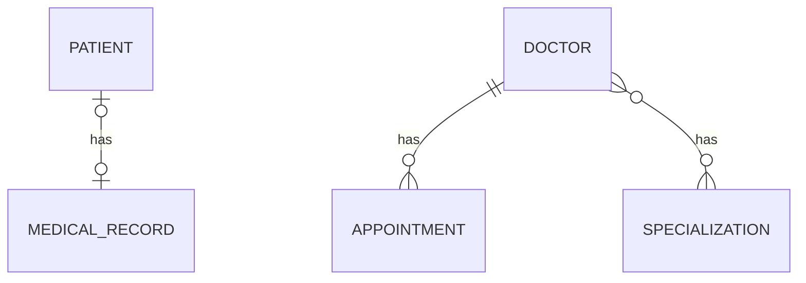

# Hospital Management API: Validation and Exception Handling Branch

> Branch: `feature/validation-exception`
> This branch builds on `feature/many-to-many` and makes the API safer: input validation, clear error responses and appointment business rules.

A Spring Boot REST API that manages patients, medical records, doctors, appointments and specializations. This branch adds **validation**, **global exception handling** and **business rules** on top of the JPA relationships.

## What this branch adds

| Area | What was added |
|---|---|
| Validation | Rules on doctor and appointment request DTOs, enforced with `@Valid` |
| Exception handling | `@RestControllerAdvice` that turns errors into clean JSON (400, 404, 409) |
| Custom exceptions | `ResourceNotFoundException`, `DuplicateResourceException` |
| Business rules | No appointments in the past, no double booking for the same doctor at the same time |

## Tech Stack

| Area | Technology |
|---|---|
| Language | Java [17] |
| Framework | Spring Boot 4.1.1 |
| Persistence | Spring Data JPA, Hibernate |
| Validation | Jakarta Bean Validation (`spring-boot-starter-validation`) |
| Database | MySQL |
| Others | Lombok, Maven |

## Database Design



| Relationship | Entities | How it is stored |
|---|---|---|
| One-to-One (uni + bi) | Patient and MedicalRecord | `patients.medical_record_id` foreign key |
| One-to-Many / Many-to-One (uni + bi) | Doctor and Appointment | `appointments.doctor_id` foreign key |
| Many-to-Many (uni + bi) | Doctor and Specialization | join table `doctor_specializations` |

## Validation Rules

| DTO | Field | Rule | Message |
|---|---|---|---|
| `DoctorRequestDto` | `name` | `@NotBlank` | Doctor name is required |
| `DoctorRequestDto` | `experience` | `@NotNull`, `@Min(0)` | Experience is required / cannot be negative |
| `AppointmentRequestDto` | `appointmentTime` | `@NotNull`, `@Future` | Appointment time must be in the future |
| `AppointmentRequestDto` | `reason` | `@NotBlank`, `@Size(max = 300)` | Reason is required / cannot be more than 300 characters |

Rules are declared on the DTO and switched on in the controller with `@Valid @RequestBody`.

## Error Handling

All errors are handled in one place, `GlobalExceptionHandler`, so every endpoint returns the same JSON shape.

| Status | When | Exception |
|---|---|---|
| 400 | Validation failed | `MethodArgumentNotValidException` |
| 404 | Doctor, patient, specialization or medical record id does not exist | `ResourceNotFoundException` |
| 409 | The doctor already has an appointment at that time | `DuplicateResourceException` |

Validation error (400):

```json
{
  "status": 400,
  "error": "Validation Failed",
  "errors": {
    "name": "Doctor name is required",
    "experience": "Experience cannot be negative"
  }
}
```

Not found (404):

```json
{
  "status": 404,
  "error": "Not Found",
  "message": "Doctor Not Found with id : 99"
}
```

Double booking (409):

```json
{
  "status": 409,
  "error": "Conflict",
  "message": "Doctor already has an appointment at this time"
}
```

The slot check uses a derived query on the repository: `existsByDoctorIdAndAppointmentTime(doctorId, appointmentTime)`.

## Project Structure

```
com.poonam.jpamapping
 ├── onetoone       (Patient, MedicalRecord)
 ├── onetomany      (Doctor, Appointment)
 ├── manytomany     (Specialization)
 └── exception      (ResourceNotFoundException, DuplicateResourceException, GlobalExceptionHandler)
```

Request flow: `Controller -> Service -> Repository -> MySQL`. Entities are never returned directly; responses always go through DTOs.

## API Endpoints

| Method | URL | Description |
|---|---|---|
| POST | `/api/patient/create` | Create a patient with a medical record |
| GET | `/api/patient/read/{id}` | Get a patient by id |
| GET | `/api/medical-record/read/{id}` | Get a medical record with its patient |
| POST | `/api/doctors/create` | Create a doctor (validated) |
| GET | `/api/doctors/read/{id}` | Get a doctor with appointments and specializations |
| POST | `/api/appointment/create/{doctorId}` | Book an appointment (validated, double booking blocked) |
| POST | `/api/specializations/create` | Create a specialization |
| GET | `/api/specializations/read/{id}` | Get a specialization with all its doctors |
| POST | `/api/doctors/{doctorId}/specializations/{specializationId}` | Assign a specialization to a doctor |

## Getting Started

### Prerequisites

- Java [17]
- Maven
- MySQL

### Setup

1. Clone the repository and switch to this branch

   ```bash
   git clone https://github.com/Poonam-D07/practice-jpa-mapping.git
   cd practice-jpa-mapping
   git checkout feature/validation-exception
   ```

2. Create the database

   ```sql
   CREATE DATABASE jpa_mapping_db;
   ```

3. Set your MySQL username and password in `src/main/resources/application.properties`

4. Run the application

   ```bash
   mvn spring-boot:run
   ```

5. Test the APIs with Postman at `http://localhost:8080`. Try sending a blank doctor name or booking the same doctor at the same time twice to see the 400 and 409 responses.

## What I learned in this branch

- Bean Validation annotations (`@NotBlank`, `@NotNull`, `@Min`, `@Size`, `@Future`) and enabling them with `@Valid`
- Keeping every rule and its error message saying the same thing
- Creating custom exceptions and handling them centrally with `@RestControllerAdvice`
- Choosing the right HTTP status: 400 (bad input), 404 (does not exist), 409 (conflicts with current state)
- Derived query methods such as `existsByDoctorIdAndAppointmentTime`
- Returning field-wise validation errors that a frontend can show next to each input

## Known limitations (fixed in later branches)

- Patient and Specialization request DTOs have no validation yet
- The slot check blocks only the exact same time, not overlapping appointment durations, and there is no database-level unique constraint, so two simultaneous requests could both pass
- No pagination, search or authentication

## Author

POONAM
https://github.com/Poonam-D07
