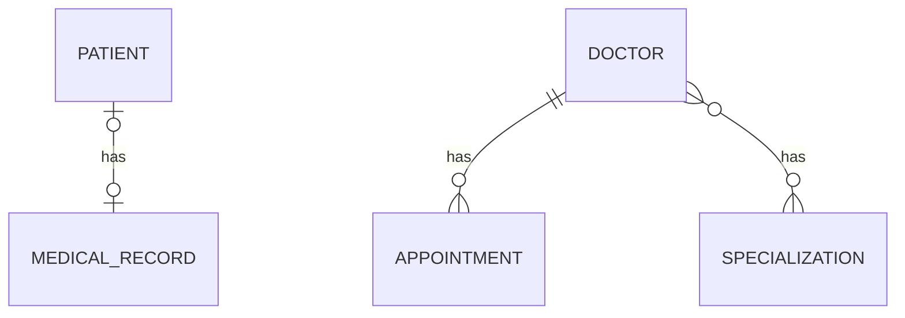

# Hospital Management API: Security Branch

> Branch: `feature/security`
> This branch builds on `feature/swagger` and adds registration, login, JWT authentication and role-based access (ADMIN and DOCTOR).

A Spring Boot REST API that manages patients, medical records, doctors, appointments and specializations. This branch secures the API: users must log in and send a token with every request, and some actions are limited to admins.

## What this branch adds

| Area | What was added |
|---|---|
| Users and roles | `UserEntity` and a `Role` enum (`ADMIN`, `DOCTOR`) |
| Registration | Public endpoint, passwords stored as BCrypt hashes |
| Login | Returns a signed JWT with the username and role |
| Authentication | `JwtAuthFilter` checks the token on every request |
| Authorization | Admin-only endpoints, configured in `SecurityConfig` |
| Swagger | An **Authorize** button to use the token from Swagger UI |

## Tech Stack

| Area | Technology |
|---|---|
| Language | Java 17 |
| Framework | Spring Boot 4.1.1 |
| Persistence | Spring Data JPA, Hibernate |
| Security | Spring Security, JWT (jjwt 0.12.6), BCrypt |
| Validation | Jakarta Bean Validation |
| API docs | springdoc-openapi 3.0.3 (Swagger UI) |
| Database | MySQL |
| Others | Lombok, Maven |

## How authentication works

```
1. POST /api/auth/register   ->  user saved, password stored as a BCrypt hash
2. POST /api/auth/login      ->  username and password checked, JWT returned
3. Any other request         ->  send the header:  Authorization: Bearer <token>
4. JwtAuthFilter             ->  verifies the signature and expiry, reads username and role
5. SecurityConfig            ->  allows or blocks the request based on the role
```

The token holds the username (`sub`), the `role`, and the issue and expiry times. It is signed with a secret key, so it cannot be changed without the server noticing. The session policy is stateless: the server remembers nothing between requests.

Key pieces:

| Class | Job |
|---|---|
| `AuthService` | Register (409 if the username exists) and login (401 on bad credentials) |
| `JwtService` | Create a token, check it, read the username and role |
| `JwtAuthFilter` | Reads the `Authorization` header and tells Spring who the user is |
| `SecurityConfig` | Which URLs are public, which need a role, and the password encoder |

Design choices:

- The role is never accepted from the registration request. Public registration always creates a `DOCTOR`, so nobody can make themselves an admin.
- Wrong username and wrong password give the same message, so nobody can find out which usernames exist.
- The token secret is read from the `JWT_SECRET` environment variable, not stored in the code.

## Access Rules

| Method | URL | Access |
|---|---|---|
| POST | `/api/auth/register` | Public |
| POST | `/api/auth/login` | Public |
| GET | `/swagger-ui/**`, `/v3/api-docs/**` | Public |
| POST | `/api/doctors/create` | ADMIN |
| POST | `/api/specializations/create` | ADMIN |
| POST | `/api/doctors/{doctorId}/specializations/{specializationId}` | ADMIN |
| All other endpoints | | Any logged-in user (ADMIN or DOCTOR) |

## Database Design



| Table | Important columns |
|---|---|
| `users` | `id`, `username` (unique), `password` (BCrypt hash), `role` (stored as text) |
| `patients`, `medical_records` | One-to-One through `patients.medical_record_id` |
| `doctors`, `appointments` | One-to-Many through `appointments.doctor_id` |
| `specializations`, `doctor_specializations` | Many-to-Many through a join table |

## Project Structure

```
com.poonam.jpamapping
 ├── onetoone       (Patient, MedicalRecord)
 ├── onetomany      (Doctor, Appointment)
 ├── manytomany     (Specialization)
 ├── auth           (UserEntity, Role, AuthService, JwtService, JwtAuthFilter, AuthController)
 ├── exception      (custom exceptions, global handler)
 ├── common         (PageResponseDto)
 └── config         (SecurityConfig, OpenApiConfig)
```

## API Endpoints

| Method | URL | Description |
|---|---|---|
| POST | `/api/auth/register` | Register a new user (role DOCTOR) |
| POST | `/api/auth/login` | Log in and receive a JWT |
| POST | `/api/patient/create` | Create a patient with a medical record |
| GET | `/api/patient/read/{id}` | Get a patient by id |
| GET | `/api/medical-record/read/{id}` | Get a medical record with its patient |
| POST | `/api/doctors/create` | Create a doctor (ADMIN) |
| GET | `/api/doctors/read/{id}` | Get a doctor with appointments and specializations |
| GET | `/api/doctors/readAll` | Get all doctors (no paging) |
| GET | `/api/doctors/paged` | Get doctors page by page, with sorting |
| GET | `/api/doctors/search?name=...` | Search doctors by name, page by page |
| POST | `/api/doctors/{doctorId}/specializations/{specializationId}` | Assign a specialization (ADMIN) |
| POST | `/api/appointment/create/{doctorId}` | Book an appointment |
| POST | `/api/specializations/create` | Create a specialization (ADMIN) |
| GET | `/api/specializations/read/{id}` | Get a specialization with all its doctors |

### Sample requests

Register: `POST /api/auth/register`

```json
{
  "username": "drverma",
  "password": "verma123"
}
```

Login: `POST /api/auth/login`

```json
{
  "username": "drverma",
  "password": "verma123"
}
```

Response (200):

```json
{
  "token": "eyJhbGciOiJIUzI1NiJ9...",
  "username": "drverma",
  "role": "DOCTOR"
}
```

Wrong credentials (401):

```json
{
  "status": 401,
  "error": "Unauthorized",
  "message": "Invalid username or password"
}
```

## Getting Started

### Prerequisites

- Java 17
- Maven
- MySQL

### Setup

1. Clone the repository and switch to this branch

   ```bash
   git clone https://github.com/Poonam-D07/practice-jpa-mapping.git
   cd practice-jpa-mapping
   git checkout feature/security
   ```

2. Create the database

   ```sql
   CREATE DATABASE jpa_mapping_db;
   ```

3. Set your MySQL username and password in `src/main/resources/application.properties`. The file should read the secret from the environment:

   ```properties
   jwt.secret=${JWT_SECRET}
   jwt.expiration-ms=3600000
   ```

4. Set `JWT_SECRET` to a long random text (at least 32 characters). In PowerShell:

   ```powershell
   $env:JWT_SECRET="your_long_random_secret"
   ```

   In IntelliJ you can add `JWT_SECRET=...` under Run, Edit Configurations, Environment variables.

5. Run the application

   ```bash
   mvn spring-boot:run
   ```

### Trying the secured APIs

1. Open `http://localhost:8080/swagger-ui/index.html`.
2. Register a user with `POST /api/auth/register`, then log in with `POST /api/auth/login` and copy the token.
3. Click **Authorize**, paste the token (without the word `Bearer`) and confirm.
4. Call any endpoint. Doctor-only users get **403** on the admin endpoints.
5. To get an ADMIN user, register normally and change the role in the database:

   ```sql
   UPDATE users SET role = 'ADMIN' WHERE username = 'your_username';
   ```

   Then log in again. The role is stored inside the token, so an old token keeps the old role.

## What I learned in this branch

- Authentication (who are you) versus authorization (what may you do)
- Hashing versus encrypting: BCrypt hashes cannot be reversed, and `matches()` is used to compare, because each hash has a random salt
- The structure of a JWT (header, payload, signature) and why the payload is readable but cannot be changed
- Stateless security: no session, the token travels with every request
- Writing a custom filter and placing it in Spring Security's filter chain
- Why Spring adds the `ROLE_` prefix, and how `hasRole("ADMIN")` uses it
- Not trusting the client for sensitive fields such as the role
- Keeping secrets out of the code with environment variables

## Known limitations (planned)

- A missing or invalid token currently returns Spring's default 403 instead of a clear 401 with a JSON message
- No refresh tokens and no logout: a token stays valid until it expires
- The first ADMIN has to be created by editing the database
- No automated tests yet, and no update or delete endpoints
- The database password is still in `application.properties` (fine for local practice, not for production)

## Author

POONAM  https://github.com/Poonam-D07
